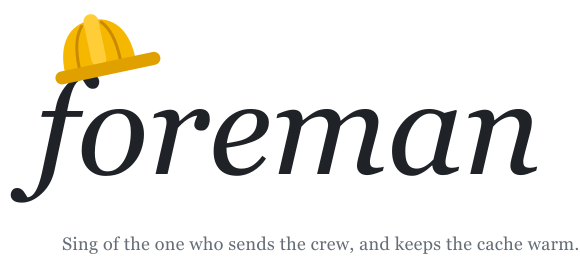

<p align="center">
  <picture>
    <source media="(prefers-color-scheme: dark)" srcset="../assets/logo-dark.svg">
    
  </picture>
</p>

Foreman is a way to run a coding project in [Kimi Code](https://www.kimi.com/code)
with one lead agent and a crew of worker agents, without running out of your usage
limit halfway through the week. It is a skill, five worker profiles and a few short
prompt files, installable as one plugin. This page explains where it came from and
how to use it. (This is the Kimi Code edition; it was adapted from a Claude Code
edition, which is where the measurements below were taken.)

## What I did before

For a while I ran a project the obvious way. I kept one long chat open as the
lead. When I wanted something built, the lead started a general-purpose sub-agent
in its own git worktree, the sub-agent opened a pull request, and I reviewed it.
Nothing was written down. The lead decided each time how to brief an agent, when
to check on it, and how much to do itself.

It worked, in the sense that pull requests got merged. Then one chat that ran for
two days used about 90% of my weekly limit, and I had no idea why. So I wrote a
script to read the transcripts and count every model call.

## What the transcripts showed

Three things explained almost all of it.

**Agents re-read their whole context on every step.** 74% of that chat's cost was
cache reads. Sub-agents ran to 300k–960k tokens without compacting, and more than
half the cost came from calls made with over 400k tokens of context. One agent,
with 615 calls and a 964k peak, took 27% of the chat by itself. The number of
agents was not the problem: the 26 agents that stayed under 200k cost 5% in total.

**The cache expired while agents waited.** A sub-agent's prompt cache lasted five
minutes by default. An end-to-end test run takes five to fifteen. Each time an
agent waited longer than the cache, its next call wrote the whole context again
at full price. That was 13.6% of the cost.

**The lead did the work itself.** In a later chat the lead made about a thousand
calls at an average of 251k tokens, and three quarters of them were its own
commands: reading diffs, running git, debugging. That work costs the same number
of steps in a worker, but each step in a worker re-reads far less.

I fixed these one at a time over the next chats, and the cost per merged pull
request fell by about 40%. But the fixes lived in my head and in the lead's
memory, and each new chat forgot some of them. Foreman is those fixes written
down as rules the agents load.

## What Foreman is

You type `/skill:foreman` (or `/foreman`) in a session, in any repository, and
that session becomes the lead. The lead plans, writes a brief for each task and
sends a worker. It does not write code, debug or run tests. Each worker takes one
brief, works in its own worktree, hands back one result and stops.

There are five kinds of worker. They differ in tools, step budget and what they
hand back:

| Worker | Job | Step budget |
|---|---|---|
| builder | Build or fix something whose cause is known, and open a PR | ~150, stop at 400 |
| investigator | Find the cause of a bug or a flaky test, and write the fix brief | ~100 |
| clerk | Merges, conflicts, renumbering, full test runs | ~150 |
| scout | Answer one factual question from the web, docs or code | ~20–40 |
| responder | Handle one round of a review bot's findings on a PR | ~80 |

The rules behind them:

- **One task, one PR, one worker.** Follow-up work after review goes to a fresh
  worker, not back to the one that has grown.
- **Workers start small.** Each profile lists only the tools that worker needs.
  The general-purpose agent I used before started at 46k tokens of context and
  re-read that on every call.
- **Workers wait in the background.** Long commands run as background tasks with
  output to a log, so a fifteen-minute test run doesn't stall a turn.
- **A handover file replaces old chats.** Each repository has one `HANDOVER.md`,
  shared by every worktree and kept out of git. A new lead starts from it. It also
  holds the repository's settings and the rules the lead copies into every brief,
  because workers can't see the lead's memory. A repository with several separate
  lines of work gets one handover per topic (`/skill:foreman-create TOPIC`,
  `/skill:foreman-resume TOPIC`) and one shared rules file.
- **One model for the lead, one for all workers.** Kimi Code runs sub-agents on
  the session's secondary model, so you pick the workers' model once with
  `/secondary-model` instead of pinning one per worker type.

One part is optional. If a review bot such as Codex must approve your pull
requests, the lead runs a watcher and sends a responder for each round, up to a
cap.

## How the first run went

The first full session under Foreman ran seven hours with 118 workers, most of
them review rounds on a stack of 22 pull requests.

What worked: no cache was rewritten after a wait, where it had been 10–14% of the
cost before. Workers started at about 10k tokens and none went above 223k.

What didn't: the lead grew to 809k tokens before it was compacted, and took 41% of
the session's cost. The rule said the lead should ask me to compact at 200k. It
didn't ask, and when I tried, a `/compact` typed while the lead was busy arrived as
plain text. The lead also posted 126 messages, far more than I could read. On
Claude Code I answered that with a mod that auto-compacts the lead; this edition
has no mods, so the 200k rule is yours to enforce again.

[`CHANGELOG.md`](CHANGELOG.md) keeps this record for each version: what changed,
what to check when testing, and what was measured.

## Setting it up

You need Kimi Code. Install the repository as a plugin:

```text
/plugins install https://github.com/chengluyu/foreman
```

or from a local checkout, `/plugins install <path>`, then `/reload`. To copy the
pieces by hand instead: `kimi/skills/foreman*/` go to `~/.kimi-code/skills/`
and `kimi/agents/foreman-*.md` to `~/.agents/agents/`. Nothing refers to where you
cloned the repository.

Pick the model the workers run on:

```text
/secondary-model
```

Then start a new session in any repository and type:

```text
/skill:foreman
```

The first time in a repository, the lead asks three things: whether a review bot
is in use, which builder profile to use, and which rules every worker must
follow. It writes the answers into the handover. After that it tells you in five
lines where things stand.

## Where to read more

- [`FOREMAN.md`](FOREMAN.md) is the full guide: how the cost works, the
  measurement behind each rule, and what changed from the Claude Code edition.
- [`skills/foreman/lead.md`](skills/foreman/lead.md) is what the lead actually
  loads. It is short on purpose, because the lead re-reads it on every step.
- [`agents/`](agents) holds the worker profiles.

Foreman is at version 0.6.0 and has run one full session (on the Claude Code
edition). Until 1.0.0, a minor version may change behaviour or cost.
